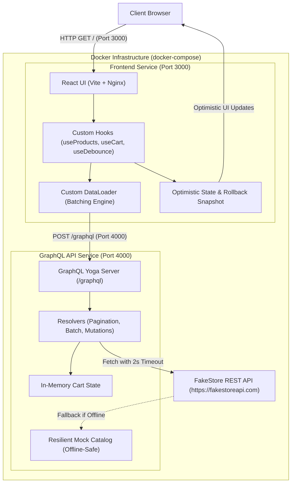

# GraphQL-Powered E-Commerce Storefront with Optimistic UI & Custom Hooks

A production-grade, high-performance e-commerce storefront engineered with a **custom lightweight GraphQL client built from scratch** (zero Apollo Client, Relay, or URQL dependencies). This project demonstrates mastery of fundamental modern frontend and full-stack patterns: Relay-style cursor-based pagination, deterministic optimistic UI updates with automatic snapshot rollback, request batching via a custom event-loop DataLoader, and query debouncing.

---

## 🏛️ System Architecture

The application is architected into two containerized microservices managed via Docker Compose:
- **`api/` (GraphQL Server)**: Built with Node.js and GraphQL Yoga, serving as a GraphQL wrapper / facade around the FakeStore API with in-memory resilient fallback and cart state management.
- **`frontend/` (React Storefront)**: Built with React, Vite, and Tailwind CSS, utilizing custom hooks (`useProducts`, `useCart`, `useDebounce`, `useProductSearch`) and a custom `DataLoader`.



---

## 🚀 Core Features & Implementation Highlights

### 1. Cursor-Based Pagination (`useProducts`)
- **Backend Schema**: `products(first: Int!, after: String): ProductConnection!`
  - Implements the Relay connection specification (`edges`, `pageInfo`, `endCursor`, `hasNextPage`).
  - Cursors are generated as base64-encoded position pointers (`Buffer.from('product:' + index).toString('base64')`), ensuring pagination stability even when items are added or removed dynamically.
- **Frontend Hook**: `useProducts(pageSize)`
  - Maintains accumulative page state. Clicking the **Load More** button (`data-testid="next-page-button"`) fetches the next slice using the previous `endCursor` and appends newly loaded products to the container (`data-testid="product-list"`).
  - Automatically disables or hides the button once the final page is reached.

### 2. Optimistic UI Updates & Transactional Rollback (`useCart`)
- **Instant UI Response**:
  - When a user clicks an "Add to Cart" button (`data-testid="add-to-cart-<id>"`), the cart counter (`data-testid="cart-count"`) increments **immediately** in the DOM before any network packet is dispatched.
- **Transactional Rollback Snapshot**:
  - Prior to sending the mutation, the hook captures a pre-mutation snapshot of the cart state.
  - If the server returns a GraphQL error (e.g., adding out-of-stock item `999`), the hook catches the rejection, reverts the cart counter and items to the exact pre-mutation state, and mounts an error notification in the DOM with `data-testid="error-toast"`.

### 3. Request Batching with Custom DataLoader (`DataLoader`)
- Solves the N+1 query problem by batching individual product lookups that occur within the same JavaScript event-loop tick.
- **Mechanism**:
  - `load(id)` returns a deferred Promise and queues the ID.
  - A microtask (`queueMicrotask`) is scheduled for the current tick.
  - When the microtask executes, all queued IDs are deduplicated and dispatched in a single GraphQL query:
    ```graphql
    query ProductsByIds($ids: [ID!]!) {
      productsByIds(ids: $ids) { id title price ... }
    }
    ```
- **Verification Hook**:
  - `window.triggerBatchFetch()` is exposed on the global `window` object. Calling `window.triggerBatchFetch()` fires three asynchronous requests for IDs `['1', '2', '3']` in the same tick, resulting in **exactly one** POST network request to `/graphql`.

### 4. Search Query Debouncing (`useDebounce` & `useProductSearch`)
- Prevents excessive server load on keystrokes in `<input data-testid="search-input" />`.
- Debounces input values with a 350ms delay. If a user types `'s-h-o-e'` with a 100ms interval between keystrokes, previous timers are cancelled, and only a single query is fired 350ms after the final keystroke.
- Includes client-side caching of search results in a session Map to make backspacing and repeated searches instantaneous.

---

## 📋 Core Requirements Contract Matrix

| # | Contract Specification | Implementation File | Verification Test ID / Mechanism |
|---|------------------------|---------------------|-----------------------------------|
| **1** | Multi-container Docker Compose with healthchecks & `depends_on: service_healthy` | `docker-compose.yml` | `docker compose up` |
| **2** | GraphQL introspection response at `POST /graphql` with CORS enabled | `api/src/server.js` | Status 200 with `__schema` |
| **3** | Cursor-based pagination schema: `products(first, after): ProductConnection!` | `api/schema.graphql`, `api/src/resolvers.js` | Relay connection with `edges` & `pageInfo` |
| **4** | Product listing & Load More button | `frontend/src/components/ProductList.jsx` | `data-testid="product-list"`, `data-testid="next-page-button"` |
| **5** | Instant optimistic cart increment | `frontend/src/context/CartContext.jsx` | `data-testid="add-to-cart-<id>"`, `data-testid="cart-count"` |
| **6** | Rollback on failure for product 999 & error notification | `api/src/resolvers.js`, `frontend/src/components/Toast.jsx` | `data-testid="add-to-cart-999"`, `data-testid="error-toast"` |
| **7** | Debounced search query (>= 300ms pause) | `frontend/src/hooks/useDebounce.js` | `data-testid="search-input"` |
| **8** | DataLoader request batching via `productsByIds(ids)` | `frontend/src/api/dataLoader.js` | `window.triggerBatchFetch()` (single request for 3 IDs) |
| **9** | Architecture Decision Record (ADR) on frontend caching | `docs/adr-caching-strategy.md` | Document exists in repository |
| **10** | Environment variables documentation | `.env.example`, `.env` | Key-value pairs defined |

---

## 🛠️ Getting Started & Running the Application

### Option A: Running with Docker Compose (Recommended)

Run the entire application with a single command from the root directory:

```bash
docker-compose up --build
```

Both containers will start and reach healthy status:
- **Frontend**: Accessible at [http://localhost:3000](http://localhost:3000)
- **GraphQL API**: Accessible at [http://localhost:4000/graphql](http://localhost:4000/graphql)

To stop the containers:
```bash
docker-compose down
```

---

### Option B: Running Locally for Development

#### 1. Backend API:
```bash
cd api
npm install
npm run dev
```
API will start on `http://localhost:4000/graphql`.

#### 2. Frontend:
```bash
cd frontend
npm install
npm run dev
```
Frontend will start on `http://localhost:3000`.

---

## 🧪 Testing & Verification Guide

### 1. Automated Unit & Integration Tests

Run the backend resolver and introspection tests:
```bash
cd api
npm test
node test/introspection.test.js
```

### 2. Manual & Headless Browser Verification

#### A. Cursor-Based Pagination
1. Open [http://localhost:3000](http://localhost:3000) with DevTools Network tab open (filter for `graphql`).
2. Verify initial products are rendered in `[data-testid="product-list"]`.
3. Click `[data-testid="next-page-button"]`.
4. Inspect the network payload: verify `after` cursor matches the `endCursor` from the previous response.
5. Verify new products are appended to `[data-testid="product-list"]`.

#### B. Optimistic UI Updates & Rollback
1. Observe that `[data-testid="cart-count"]` shows `0`.
2. Click `[data-testid="add-to-cart-1"]`.
   - `[data-testid="cart-count"]` increments instantly to `1` before the network request finishes.
3. Click `[data-testid="add-to-cart-999"]` (the Demo Out of Stock card):
   - Counter increments optimistically to `2`.
   - Once the server responds with a GraphQL error (product 999 unavailable), the counter reverts back to `1`.
   - An error toast with `[data-testid="error-toast"]` appears in the bottom right corner.

#### C. Debounced Product Search
1. Focus `<input data-testid="search-input" />`.
2. Type `s-h-o-e` with quick keystrokes (< 200ms apart).
3. Observe Network tab: no network requests are sent during typing.
4. Stop typing: 350ms later, exactly **one** GraphQL search query is dispatched.

#### D. DataLoader Request Batching
1. Open the browser Developer Console.
2. Run:
   ```javascript
   await window.triggerBatchFetch();
   ```
3. Inspect the Network tab:
   - Exactly **one** HTTP POST request to `/graphql` is sent.
   - The payload variables contain `{ "ids": ["1", "2", "3"] }`.
   - The three returned products resolve concurrently.

---

## 📁 Repository Structure

```
├── .env.example                # Documented environment variables
├── .env                        # Local environment configuration
├── docker-compose.yml          # Container orchestration with healthchecks
├── README.md                   # Comprehensive project documentation
├── docs/
│   └── adr-caching-strategy.md # Architecture Decision Record for caching
├── api/
│   ├── Dockerfile              # Production Node.js container
│   ├── package.json            # Backend dependencies & test scripts
│   ├── schema.graphql          # Complete GraphQL schema definition
│   ├── src/
│   │   ├── server.js           # GraphQL Yoga HTTP server & CORS setup
│   │   ├── resolvers.js        # Resolvers (pagination, search, batch, cart)
│   │   ├── data.js             # FakeStore fetcher with resilient fallback
│   │   └── mockData.js         # Bundled offline mock dataset
│   └── test/
│       ├── api.test.js         # Unit tests for pagination, search, rollback
│       └── introspection.test.js # GraphQL introspection validation
└── frontend/
    ├── Dockerfile              # Multi-stage build + Nginx static server
    ├── nginx.conf              # Nginx routing & caching configuration
    ├── package.json            # React, Vite, and Tailwind dependencies
    ├── vite.config.js          # Vite build and preview configuration
    ├── index.html              # HTML shell
    └── src/
        ├── main.jsx            # Application entrypoint
        ├── App.jsx             # Main storefront layout & state wiring
        ├── index.css           # Styling
        ├── api/
        │   ├── graphqlClient.js # Lightweight POST fetch client
        │   ├── queries.js       # GraphQL queries and mutations
        │   └── dataLoader.js    # Custom DataLoader with window.triggerBatchFetch
        ├── context/
        │   └── CartContext.jsx  # Cart state, optimistic updates & rollback
        ├── hooks/
        │   ├── useProducts.js   # Cursor-based pagination hook
        │   ├── useDebounce.js   # Generic debounce hook
        │   ├── useProductSearch.js # Debounced search hook with cache
        │   └── useCart.js       # Cart hook export
        └── components/
            ├── Header.jsx       # Header with data-testid="cart-count"
            ├── SearchBar.jsx    # Search input with data-testid="search-input"
            ├── ProductCard.jsx  # Card with data-testid="add-to-cart-<id>"
            ├── ProductList.jsx  # List with data-testid="product-list" & next-page-button
            ├── CartDrawer.jsx   # Slide-over cart inspector
            └── Toast.jsx        # Notification with data-testid="error-toast"
```
